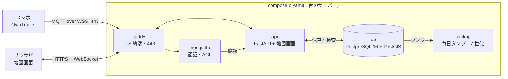

# OwnTracks 位置記録サーバー

OwnTracks アプリの位置情報を MQTT over WSS で受け取り、OwnTracks Recorder で保存・地図表示する。
参考構成(oYAs-me/tracks-position)との違いは次の 4 点。

- Mosquitto の匿名接続を禁止し、ユーザー名・パスワードと ACL(自分のトピックにだけ書ける)を必須にした
- リバースプロキシを Caddy にして Compose に含めた(証明書の取得・更新が自動)
- Mosquitto と Recorder はポートを公開せず、Docker 内部ネットワークだけで通信する
- イメージのバージョンを固定した(`latest` を使わない)

機能要件・非機能要件は [docs/requirements.md](docs/requirements.md)、セキュリティ確認の結果は [docs/security.md](docs/security.md) を参照。

このリポジトリには 2 つの構成がある。スマホ(OwnTracks)の設定はどちらも同じ。

| 構成 | 中身 | 手順 |
| --- | --- | --- |
| 案A(このページ) | Mosquitto + OwnTracks Recorder + Caddy。設定ファイルだけで動く | 以下 |
| 案B | Mosquitto + 自作 API(FastAPI)+ PostgreSQL/PostGIS + 自作の地図画面。共有設定・管理画面・書き出し・自動削除・バックアップ付き | 本番に載せる手順: [docs/deploy.md](docs/deploy.md)(サーバーが無ければ [Oracle Cloud の無料 VM](docs/oracle-cloud.md))、構成と機能: [docs/plan-b.md](docs/plan-b.md) |

## 構成

### 案B(主に使う構成)

外部に開くのは 80/443 だけで、残りは Docker の内部ネットワークで完結する。backup が毎日 DB をダンプする。



| サービス | イメージ | 役割 |
| --- | --- | --- |
| caddy | caddy:2.11.9 | TLS 終端、`MQTT_DOMAIN` → mosquitto、`APP_DOMAIN` → api |
| mosquitto | eclipse-mosquitto:2.0.23 | MQTT ブローカー。認証 + ACL |
| api | `api/Dockerfile`(または ghcr.io の公開イメージ) | 位置の受信・保存、REST・WebSocket、地図画面の配信 |
| db | postgis/postgis:16-3.7 | 位置履歴・利用者・共有設定・場所 |
| backup | postgis/postgis:16-3.7 | 毎日 DB をダンプし `backups/` に 7 世代残す |

手順は [docs/deploy.md](docs/deploy.md) を参照。

### 案A

```
スマホ(OwnTracks) --WSS:443--> Caddy --> Mosquitto:9001
                                              |  購読(1883, 内部のみ)
ブラウザ --HTTPS:443 + Basic認証--> Caddy --> Recorder:8083
```

| サービス | イメージ | 役割 |
| --- | --- | --- |
| caddy | caddy:2.11.9 | TLS 終端、`MQTT_DOMAIN` → Mosquitto、`APP_DOMAIN` → Recorder |
| mosquitto | eclipse-mosquitto:2.0.23 | MQTT ブローカー。認証 + ACL |
| recorder | owntracks/recorder:1.0.7 | 位置の保存と地図画面 |

案A はバックアップのコンテナを持たない(Recorder の保存データのバックアップ方法は下の「運用」を参照)。以下は案A の手順。

## 準備

- Docker と Docker Compose が入った Linux サーバー(VPS など)
- ドメイン 2 つ分の DNS A レコード(例: `mqtt.example.com` と `map.example.com`)をサーバーの IP に向ける
- サーバーのファイアウォールで 80/tcp・443/tcp・443/udp を開ける

## セットアップ

```bash
# 1. 設定ファイルを作る
cp .env.example .env
#    .env のドメイン・ACME_EMAIL・RECORDER_MQTT_PASS を書き換える

# 2. 地図画面のパスワードハッシュを作り、.env の WEB_PASS_HASH にシングルクォートで囲んで貼る
bash scripts/hash-web-password.sh

# 3. Mosquitto のパスワードファイルを作る(Recorder 用アカウントを登録)
bash scripts/init.sh

# 4. 端末ごとにアカウントを追加(ユーザー名は英数字)
bash scripts/add-user.sh taro

# 5. 起動
docker compose up -d
docker compose logs -f
```

## OwnTracks アプリの設定

| 項目 | 値 |
| --- | --- |
| Mode | MQTT |
| Host | `MQTT_DOMAIN` の値(例: `mqtt.example.com`) |
| Port | 443 |
| WebSocket | ON |
| TLS | ON |
| Username / Password | `add-user.sh` で登録したもの |
| Device ID | 任意(例: `iphone`)。トピックは `owntracks/<Username>/<Device ID>` になる |
| Tracker ID | 2 文字(地図のマーカーに表示) |

送信頻度は Monitoring モード(Significant / Move)で調整する。Move は精度が高いが電池を多く使う。

地図画面は `https://<APP_DOMAIN>/` で開き、`WEB_USER` と手順 2 のパスワードでログインする。

## 運用

```bash
# 利用者の削除
bash scripts/add-user.sh -D taro

# 2023 年の履歴を削除
docker compose exec recorder sh -c 'find /store/rec -name "2023-*.rec" -delete'

# バックアップ(Recorder の保存データ)
docker run --rm -v owntracks-server_recorder_store:/store -v "$PWD":/backup alpine \
  tar czf /backup/recorder-store-$(date +%F).tar.gz -C /store .

# 全データ削除(元に戻せない)
docker compose down -v
```

ボリューム名はフォルダ名が先頭に付く(`<フォルダ名>_recorder_store`)。`docker volume ls` で確認する。

## 家族・友人の位置をアプリ上でも見たい場合

`mosquitto/config/acl` の `# pattern read owntracks/+/+` のコメントを外し、
`docker compose kill -s HUP mosquitto` で再読み込みする。全ユーザーが全員の位置を読めるようになる点に注意。

## トラブル時の確認

- 証明書が取れない: DNS が向いているか、80 番が開いているかを `docker compose logs caddy` で確認
- アプリが繋がらない: `docker compose logs mosquitto` に `not authorised` が出ていれば、ユーザー名・パスワードか ACL の不一致
- Recorder に記録されない: `docker compose logs recorder` で MQTT 接続エラーを確認(`RECORDER_MQTT_PASS` と passwd の不一致など)
