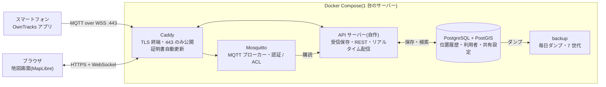

# 位置共有サービス 要件定義書

作成日: 2026-11-20 / 最終更新: 2026-11-26

## 1. 概要

本サービスは、スマートフォンの位置情報を自前サーバーに集め、地図上で現在地と移動履歴を見られるようにする個人・少人数向けの位置記録サービスである。参考にした [oYAs-me/tracks-position](https://github.com/oYAs-me/tracks-position) は、既製アプリ OwnTracks の受け口を Docker Compose で立てる構成で、独自コードはほぼ設定ファイルのみ。

2026-11-26 時点で、案 A(Recorder 利用)と案 B(自作 API + DB)はどちらも実装済み。コードと手順は [0tsu-0w0/map-tracking](https://github.com/0tsu-0w0/map-tracking) にあり、CI で構成一式の通しテストを毎回行っている。本書では各要件に実装状況を併記する。未確認は実機(スマホの OwnTracks)での接続だけ。

### 1.1 参考リポジトリの構成

| 要素 | 役割 | 実体 |
| --- | --- | --- |
| OwnTracks(スマホアプリ) | 位置を測って送信 | iOS / Android の既製アプリ |
| Nginx(ホスト側) | TLS 終端、WebSocket 中継、Web UI の Basic 認証 | Docker 外で手動設定 |
| Mosquitto | MQTT ブローカー(WebSocket 9001 / 内部 1883) | `eclipse-mosquitto:2` |
| OwnTracks Recorder | MQTT を購読して保存、地図 Web UI と HTTP API | `owntracks/recorder:latest` |
| 保存先 | 履歴 `/store/rec/YYYY-MM.rec`、最新位置 `/store/last` | Docker ボリューム(ファイル) |

### 1.2 参考構成から引き継ぐ点・改める点

- 引き継ぐ: スマホ送信は MQTT over WSS(443)、TLS はリバースプロキシで終端、データは自分のサーバーにだけ置く。
- 改める: Mosquitto が `allow_anonymous true` のまま 443 で公開されており、誰でも位置を送受信できる。本要件ではブローカー認証と ACL を必須にする。
- 改める: `.env.example` の Recorder 認証値はどこからも使われていない。設定は 1 か所にまとめる。
- 改める: Nginx が Docker 外の手作業で、再現しにくい。リバースプロキシも Compose に含める。

### 1.3 スコープ

- 対象: 位置の受信・保存・地図表示・履歴検索・データ削除、利用者と端末の管理、共有設定、ジオフェンス、書き出し、運用(バックアップ・更新・監視)。
- 対象外(初版): 位置送信アプリの自作(OwnTracks を使う)、複数組織での共用、Web ログインの 2 段階認証。

## 2. 利用者と利用シナリオ

想定利用者は、管理者 1 名と、その家族・友人など数名(最大 10 名程度)の閲覧・送信者である。

| 利用者 | やること |
| --- | --- |
| 管理者 | サーバー構築、利用者・端末の登録、データ削除、バックアップ |
| 送信者(端末の持ち主) | スマホに OwnTracks を入れ、自分の位置を送る |
| 閲覧者 | ブラウザで許可された人の現在地と履歴を見る |

主なシナリオ:

1. 管理者が利用者を登録し、接続設定(ホスト・ユーザー名・パスワード)を渡す。
2. 送信者が OwnTracks を設定し、以後はバックグラウンドで位置が送られる。
3. 閲覧者が Web 画面にログインし、地図で現在地を確認する。
4. 閲覧者が日付を選び、その日の移動経路を地図上の線で見る。
5. 管理者が古い履歴(例: 2023 年分)を削除する。

## 3. 機能要件

必須(Must)は参考構成と同等の機能に認証を加えたもので、これだけで初版として成立する。

| ID | 機能 | 内容 | 優先度 | 実装状況(案 B) |
| --- | --- | --- | --- | --- |
| F-01 | 位置受信(MQTT) | OwnTracks から MQTT over WSS(443)で `owntracks/<user>/<device>` に届く JSON(`_type: location`)を受ける | Must | 済。QoS 1 + 永続セッションで、API 停止中の位置もブローカーが溜める |
| F-02 | 位置受信(HTTP) | MQTT が使えない環境向けに HTTPS POST でも同じ JSON を受ける | Should | 済(`/api/pub`、Web と同じ名前・パスワード) |
| F-03 | 端末認証 | ユーザー名・パスワードでブローカーに接続。匿名接続は拒否 | Must | 済 |
| F-04 | トピック ACL | 送信者は自分のトピックにだけ書き込める。他人の位置は許可した相手だけ読める | Must | 済(アプリ上で全員を見せる設定は ACL の 1 行で切り替え) |
| F-05 | 位置の保存 | 緯度・経度・測位精度・速度・バッテリー・時刻を履歴として保存し、最新位置も別に保持 | Must | 済(生 JSON も保存、同じ点の二重登録なし) |
| F-06 | 現在地表示 | Web 地図に各利用者の最新位置をマーカーで表示。新着は再読み込みなしで反映 | Must | 済(WebSocket で配信) |
| F-07 | 履歴表示 | 利用者と期間を選び、移動経路を線で表示 | Must | 済(1 日単位、前後の日へ移動可) |
| F-08 | Web ログイン | 閲覧画面はログイン必須(参考構成は Nginx の Basic 認証) | Must | 済(Cookie セッション + Argon2) |
| F-09 | データ削除 | 期間指定・利用者指定・全削除。参考構成はコマンドでのファイル削除 | Must | 済(その日・端末の全履歴・端末ごと・利用者ごと) |
| F-10 | 利用者・端末管理 | 追加・無効化・パスワード再設定 | Should | 済(管理画面と `member.sh`。MQTT と Web のアカウント、スマホ用 QR を一括作成) |
| F-11 | エクスポート | 履歴を GPX / GeoJSON / CSV で取り出す | Should | 済 |
| F-12 | 自動削除 | 保存期間(例: 365 日)を過ぎた履歴を定期削除 | Should | 済(6 時間ごと) |
| F-13 | 共有設定 | 誰が誰の位置を見られるかを利用者ごとに設定 | Could | 済(管理者は全員を見られる) |
| F-14 | ジオフェンス | 登録地点への出入りを記録・通知(OwnTracks の Waypoint/Transition を利用) | Could | 済(サーバー側で判定 + OwnTracks 側の Regions も記録。画面と Webhook で通知) |
| F-15 | 統計 | 日別の移動距離や滞在地点 | Could | 一部(直近 7 日の日別移動距離のみ。滞在地点は未実装) |

受け取る位置メッセージの例(OwnTracks の JSON 形式):

```json
{"_type":"location","tid":"ab","lat":35.6812,"lon":139.7671,"acc":12,"alt":40,"vel":0,"batt":85,"conn":"w","tst":1763600000}
```

## 4. 非機能要件

位置情報は最も機微な個人情報の一つなので、セキュリティとプライバシーを性能より優先する。数値は 10 名規模を前提とした目安。

| 区分 | 要件 | 目標値・具体策 | 実装状況(案 B) |
| --- | --- | --- | --- |
| セキュリティ | 通信の暗号化 | 外部に出る通信はすべて TLS 1.2 以上。証明書は Let's Encrypt で自動更新 | 済(Caddy。HSTS・CSP も付与) |
| セキュリティ | 認証 | MQTT は匿名拒否 + パスワードハッシュ。Web はログイン必須(可能なら OIDC や 2 段階認証) | 済(総当たり対策あり)。2 段階認証・OIDC は未実装 |
| セキュリティ | 公開範囲 | 外部公開は 443 のみ。ブローカー・DB は 127.0.0.1 または Docker 内部ネットワークに限定 | 済(80 は証明書取得と転送のみ) |
| セキュリティ | 秘密情報 | パスワード・鍵は `.env` 等で管理し Git に含めない | 済(`setup.sh` がランダム生成し、`.env` を権限 600 で作成) |
| セキュリティ | 端末側暗号化(任意) | OwnTracks のペイロード暗号化(libsodium の共通鍵)を使えるようにする | 済(利用者ごとの鍵で復号。鍵はサーバーの DB に保存) |
| プライバシー | 本人の同意と削除権 | 送信者の同意を取り、本人が自分の履歴を削除できる | 削除は済。同意は運用で取る |
| プライバシー | 保存期間 | 既定 365 日。設定で変更可 | 済(`RETENTION_DAYS`) |
| 性能 | 反映の速さ | 受信から地図への反映まで 2 秒以内 | 済(通しテストでは数百ミリ秒。実環境では未計測) |
| 性能 | 履歴の表示 | 1 日分(最大約 3,000 点)を 1 秒以内に描画 | 未計測(1 回の取得は最大 20,000 点) |
| 容量 | データ量 | 1 点約 200 B × 1 人 1 日 3,000 点 × 10 人 × 365 日 ≒ 2.2 GB/年 | — |
| 可用性 | 稼働 | 個人用途のため 99% 程度でよい。停止中の位置は端末側が溜めて再送する(QoS 1) | 済 |
| 可用性 | 自動復旧 | コンテナは `restart: unless-stopped` とヘルスチェック | 済 |
| 保守性 | 再現性 | `docker compose up -d` と `.env` だけで構築できる。イメージはバージョン固定(`latest` を使わない) | 済(`setup.sh` 1 本で構築。API のイメージは amd64 / arm64 を公開) |
| 保守性 | ドキュメント | 構成・選定理由・端末設定手順を `docs/` に残す(参考リポジトリと同じ方針) | 済(deploy・plan-b・security・oracle-cloud) |
| 運用 | バックアップ | 毎日 DB をダンプし、別の場所に 7 世代保管 | 同じサーバーへの 7 世代保管と復元は済。別の場所へのコピーは運用(rsync など) |
| 運用 | 監視 | 最終受信から N 時間途絶えたら管理者に通知。ログはローテーション | 済(Webhook で通知、ログは 10 MB × 3、`doctor.sh` で状態確認) |
| 互換性 | 端末 | OwnTracks iOS / Android の現行版。ブラウザは主要 4 種とスマホ表示 | 画面はスマホ幅に対応。OwnTracks 実機では未確認 |
| 端末負荷 | バッテリー | 送信間隔は OwnTracks のモード(Significant / Move)で調整できるよう手順に記す | 済(配る設定は Significant) |

セキュリティの確認結果と対策の詳細は [security.md](security.md) にまとめた。

## 5. 技術スタックとシステム構成

案 A と案 B はどちらも実装済みで、`.env` の `COMPOSE_FILE` で切り替える。今後は案 B を主に使う。どちらも端末は OwnTracks のままなので、切り替えてもスマホ側の設定は変わらない。

| 案 | 中身 | 実装 | 向き不向き |
| --- | --- | --- | --- |
| A: Recorder 利用 | Mosquitto + OwnTracks Recorder + Caddy | `compose.yaml`(設定ファイルのみ。手順は [README.md](../README.md)) | すぐ使える。画面の改造や共有設定はできず、データはファイル保存 |
| B: 自作 | Mosquitto + 自作 API + PostgreSQL/PostGIS + 自作地図画面 + Caddy + バックアップ | `compose.b.yaml`・`api/`・`web/`・`scripts/`(手順は [deploy.md](deploy.md)、機能は [plan-b.md](plan-b.md)) | F-01〜F-15 を実装済み。導入・運用はスクリプトで自動化 |

案 A の Recorder の履歴は、案 B に取り込める(`python -m app.cli import-recorder`)。

### 5.1 採用した技術(案 B)

| レイヤー | 採用(バージョン) | 当初の代替案 | 選定理由 |
| --- | --- | --- | --- |
| 端末アプリ | OwnTracks(iOS / Android) | GPSLogger(Android, HTTP 送信) | バックグラウンド測位と省電力制御を自作せずに済む |
| リバースプロキシ | Caddy 2.11.9 | Nginx + certbot(参考構成) | 証明書の取得・更新が自動で、Compose に入れやすい |
| MQTT ブローカー | Mosquitto 2.0.23(`password_file` + `acl_file`) | EMQX | 軽量で、OwnTracks の実績が多い |
| API サーバー | Python 3.12 + FastAPI + aiomqtt + asyncpg | TypeScript + Hono + mqtt.js | MQTT 購読、REST、WebSocket を 1 プロセスで書ける |
| DB | PostgreSQL 16 + PostGIS 3.7 | SQLite + SpatiaLite | 範囲検索・距離計算・ジオフェンスの判定を SQL で書ける |
| 地図画面 | React 19 + Vite 8 + MapLibre GL JS 6 | Leaflet | 経路の線や場所の円を描きやすい |
| 地図タイル | 国土地理院の標準地図(既定)。`MAP_STYLE_URL` で MapTiler 等に変更可 | MapTiler 等の無料枠 | API キーが要らず、日本国内の表示に強い |
| Web 認証 | Cookie セッション + Argon2 | Authelia / OIDC | 少人数なら自前で十分。外部 IdP は後から足せる |
| 暗号化 | PyNaCl(libsodium の secretbox) | — | OwnTracks の暗号化と同じ方式 |
| 実行環境 | Docker Compose(`setup.sh` で構築) | — | `.env` と 1 コマンドで再現できる |
| CI | GitHub Actions(単体・結合テスト、構成一式の通しテスト、ghcr.io へのイメージ公開) | — | 無料枠で足りる |

### 5.2 構成

外部に開くのは 443 だけで、残りは Compose 内で完結する。



スマホは WSS で Caddy 経由で Mosquitto に送り、自作 API がそれを購読して DB に書き、ブラウザには WebSocket で新着を配る。参考構成と同様、OwnTracks は WebSocket のパスを指定できないため、MQTT はサブドメイン(例: `mqtt.example.com`)に分けてルートで受ける。

backup コンテナは毎日 DB をダンプし、サーバーの `backups/` に 7 世代残す(別の場所へのコピーは運用で行う)。地図画面はビルドして API のイメージに入れ、API が配信する。

### 5.3 動かす場所

Linux サーバーを持たない場合は、Oracle Cloud の Always Free の VM と sslip.io を使えば、サーバーもドメインも無料で動かせる。

| 動かす場所 | 費用 | ドメイン | 手順 | 注意 |
| --- | --- | --- | --- | --- |
| Oracle Cloud Always Free(Ampere A1 2 OCPU / 12 GB) | 無料 | sslip.io(`map.<IP>.sslip.io`)。後から独自ドメインに変更可 | [oracle-cloud.md](oracle-cloud.md)(VM 作成時に cloud-init を貼るだけで初期設定) | 7 日間使われていない VM は回収されうる。sslip.io は第三者のサービス |
| VPS(1 vCPU / 1〜2 GB) | 月 500〜1,500 円 | 独自ドメイン(年 1,000〜2,000 円)か sslip.io | [deploy.md](deploy.md) | メモリ 1 GB なら `setup.sh --prebuilt` |
| 手元の PC(Docker Desktop) | 無料 | なし(`map.localhost`) | `setup.sh --local` | お試し専用。スマホからはつながらない |

## 6. データモデル・API 設計(案 B)

テーブルは 8 つ(当初の 4 つに、ログインのセッションとジオフェンス用の 3 つを足した)。位置履歴は増え続けるので、`(device_id, recorded_at)` の一意制約(複合インデックスを兼ねる)と地点の GiST インデックスを張る。利用者名は MQTT のユーザー名と同じにし、位置が先に届いた利用者と端末は自動で作る。

| テーブル | 主な列 | 備考 |
| --- | --- | --- |
| users | id, name, password_hash, role(admin / member), disabled, enc_key, created_at | name は MQTT のユーザー名。enc_key は OwnTracks の暗号化キー |
| devices | id, user_id, name, tid, last_seen_at | name は OwnTracks の Device ID。1 人複数端末可 |
| locations | id, device_id, recorded_at(tst), received_at, geom(Point, 4326), accuracy_m, altitude_m, velocity_kmh, battery_pct, conn, raw(jsonb) | 生 JSON も保持して後から項目を足せるようにする |
| shares | owner_user_id, viewer_user_id, created_at | F-13。誰が誰を見られるか |
| sessions | token_hash, user_id, expires_at | F-08。トークンそのものでなく SHA-256 を保存 |
| places | id, user_id, name, geom, radius_m(20〜50,000), notify | F-14。登録した場所(円) |
| place_presence | place_id, device_id, inside, changed_at | F-14。端末が各場所の中にいるか(出入りの判定用) |
| place_events | place_id, place_owner, device_id, place_name, event(enter / leave), source(server / device), occurred_at | F-14。出入りの記録 |

重複対策: QoS 1 では同じメッセージが再送されうるため、`(device_id, recorded_at)` を一意制約にして二重登録を防ぐ。

| メソッド | パス | 内容 | 機能 |
| --- | --- | --- | --- |
| POST | /api/auth/login, /api/auth/logout | ログイン・ログアウト | F-08 |
| GET / POST / PUT | /api/auth/me, /api/auth/password, /api/auth/encryption-key | 自分の情報・パスワード変更・暗号化キーの登録 | F-08 |
| GET | /api/devices | 見られる端末の一覧と最新位置 | F-06 |
| GET | /api/devices/{id}/locations?from=&to= | 期間の履歴(GeoJSON。最大 93 日) | F-07 |
| GET | /api/devices/{id}/export?format=gpx\|geojson\|csv | 書き出し(期間省略で全期間) | F-11 |
| DELETE | /api/devices/{id}/locations?from=&to=, /api/devices/{id} | 期間指定削除・端末ごと削除 | F-09 |
| GET | /api/devices/{id}/stats, /api/devices/{id}/events | 日別の移動距離・出入りの記録 | F-15, F-14 |
| GET / POST / PATCH / DELETE | /api/places | 場所の登録・変更・削除 | F-14 |
| GET / POST / DELETE | /api/shares | 共有設定 | F-13 |
| POST | /api/pub | OwnTracks の HTTP モード受信(Basic 認証) | F-02 |
| GET / POST / PATCH / DELETE | /api/admin/users | 利用者管理(管理者のみ) | F-10 |
| WS | /api/ws | 新着位置と出入りのプッシュ配信 | F-06, F-14 |

書き換え系(POST / PATCH / PUT / DELETE)は `X-Requested-With: fetch` ヘッダー必須(CSRF 対策。`/api/pub` を除く)。

MQTT の ACL は `pattern readwrite owntracks/%u/#` で「自分のトピックにだけ書ける」を実現し、サービス用の内部ユーザー(`api`・`recorder`)にだけ `owntracks/#` の読み取りを許す。API は `owntracks/+/+`(位置)と `owntracks/+/+/event`(出入り)を購読する。

## 7. 必要なものと開発ロードマップ

Oracle Cloud の無料 VM と sslip.io を使えば、費用 0 円で始められる。長く安定して使うなら独自ドメイン(年 1,000〜2,000 円)を足す。金額は一般的な相場の目安。

| 必要なもの | 用途 | 費用の目安(概算) |
| --- | --- | --- |
| サーバー: Oracle Cloud Always Free の VM(または VPS) | 実行環境 | 無料(VPS なら月 500〜1,500 円) |
| ドメイン: sslip.io(または独自ドメイン) | TLS 証明書と接続先(`mqtt.` / `map.`) | 無料(独自ドメインなら年 1,000〜2,000 円) |
| 地図タイル | 地図画面の背景 | 無料(国土地理院。API キー不要) |
| スマホ + OwnTracks | 位置の送信 | 無料 |
| 手元の PC | ブラウザと SSH(Windows 標準)。開発するなら Docker Desktop・Python 3.12・Node.js 22 | 無料 |
| GitHub リポジトリ | コード管理・CI・イメージ公開 | 無料 |
| バックアップの置き場 | サーバーの外にコピーを置く(手元の PC など) | 無料〜月数十円 |

必要な知識: Linux の基本操作、Docker Compose、DNS と TLS、MQTT(トピック・QoS・retain)、SQL、地図ライブラリの使い方。

### 開発ロードマップ

| フェーズ | 内容 | 状況 |
| --- | --- | --- |
| 0 | 案 A を構築(認証・ACL・Caddy・バージョン固定) | 完了 |
| 1 | 自作 API の受信保存(F-01, F-03〜F-05)、Recorder の履歴の取り込み | 完了 |
| 2 | 地図画面とログイン(F-06〜F-09) | 完了 |
| 3 | 管理画面・書き出し・自動削除・バックアップ・監視(F-10〜F-12、運用要件) | 完了 |
| 4 | 共有設定・ジオフェンス・統計(F-13〜F-15)、暗号化 | 完了(滞在地点の統計のみ未実装) |
| 5 | 導入・運用の自動化(`setup.sh`・`member.sh` ほか)、構成一式の通しテスト、Oracle Cloud での手順 | 完了 |
| 6 | 実際のサーバーに載せ、OwnTracks 実機で接続を確かめる | 未着手 |

### 未決事項

- 実機の OwnTracks(iOS / Android)で、QR コードから設定を読み込んでつながるか(未確認)
- Oracle Cloud の使われていない VM の回収を避けるか(従量課金へのアップグレード。Always Free の範囲なら請求なし)
- sslip.io のまま使うか、独自ドメインを取るか
- バックアップをサーバーの外のどこに置くか
- 利用人数と保存期間の確定値(既定は 365 日)

解決済み: API の言語は Python(FastAPI)に決定。サーバーは自宅や VPS ではなく Oracle Cloud の無料 VM を第一候補にした。

## 参考

- [0tsu-0w0/map-tracking](https://github.com/0tsu-0w0/map-tracking)(このサービスの実装。[deploy.md](deploy.md)・[plan-b.md](plan-b.md)・[security.md](security.md)・[oracle-cloud.md](oracle-cloud.md))
- [oYAs-me/tracks-position](https://github.com/oYAs-me/tracks-position)(参考にした構成。readme.md、docs/conditions.md、docs/nginx-setup.md、docker_compose.yml、mosquitto.conf を参照)
- [Oracle Cloud Always Free Resources](https://docs.oracle.com/en-us/iaas/Content/FreeTier/resourceref.htm)(無料枠の量と回収の条件)
