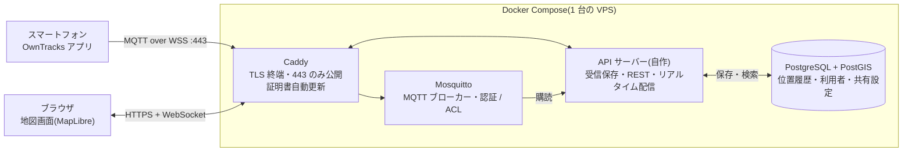

# 位置共有サービス 要件定義書

作成日: 2026-11-20

## 1. 概要

本サービスは、スマートフォンの位置情報を自前サーバーに集め、地図上で現在地と移動履歴を見られるようにする個人・少人数向けの位置記録サービスである。参考にした [oYAs-me/tracks-position](https://github.com/oYAs-me/tracks-position) は、既製アプリ OwnTracks の受け口を Docker Compose で立てる構成で、独自コードはほぼ設定ファイルのみ。

### 1.1 参考リポジトリの構成

| 要素 | 役割 | 実体 |
| --- | --- | --- |
| OwnTracks(スマホアプリ) | 位置を測って送信 | iOS / Android の既製アプリ |
| Nginx(ホスト側) | TLS 終端、WebSocket 中継、Web UI の Basic 認証 | Docker 外で手動設定 |
| Mosquitto | MQTT ブローカー(WebSocket 9001 / 内部 1883) | `eclipse-mosquitto:2` |
| OwnTracks Recorder | MQTT を購読して保存、地図 Web UI と HTTP API | `owntracks/recorder:latest` |
| 保存先 | 履歴 `/store/rec/YYYY-MM.rec`、最新位置 `/store/last` | Docker ボリューム(ファイル) |

### 1.2 参考構成から引き継ぐ点・改める点

- 引き継ぐ: スマホ送信は MQTT over WSS(443)、TLS はリバースプロキシで終端、データは自分のサーバーにだけ置く。
- 改める: Mosquitto が `allow_anonymous true` のまま 443 で公開されており、誰でも位置を送受信できる。本要件ではブローカー認証と ACL を必須にする。
- 改める: `.env.example` の Recorder 認証値はどこからも使われていない。設定は 1 か所にまとめる。
- 改める: Nginx が Docker 外の手作業で、再現しにくい。リバースプロキシも Compose に含める。

### 1.3 スコープ

- 対象: 位置の受信・保存・地図表示・履歴検索・データ削除、利用者と端末の管理。
- 対象外(初版): 位置送信アプリの自作(OwnTracks を使う)、ジオフェンス通知、複数組織での共用。

## 2. 利用者と利用シナリオ

想定利用者は、管理者 1 名と、その家族・友人など数名(最大 10 名程度)の閲覧・送信者である。

| 利用者 | やること |
| --- | --- |
| 管理者 | サーバー構築、利用者・端末の登録、データ削除、バックアップ |
| 送信者(端末の持ち主) | スマホに OwnTracks を入れ、自分の位置を送る |
| 閲覧者 | ブラウザで許可された人の現在地と履歴を見る |

主なシナリオ:

1. 管理者が利用者を登録し、接続設定(ホスト・ユーザー名・パスワード)を渡す。
2. 送信者が OwnTracks を設定し、以後はバックグラウンドで位置が送られる。
3. 閲覧者が Web 画面にログインし、地図で現在地を確認する。
4. 閲覧者が日付を選び、その日の移動経路を地図上の線で見る。
5. 管理者が古い履歴(例: 2023 年分)を削除する。

## 3. 機能要件

必須(Must)は参考構成と同等の機能に認証を加えたもので、これだけで初版として成立する。

| ID | 機能 | 内容 | 優先度 |
| --- | --- | --- | --- |
| F-01 | 位置受信(MQTT) | OwnTracks から MQTT over WSS(443)で `owntracks/<user>/<device>` に届く JSON(`_type: location`)を受ける | Must |
| F-02 | 位置受信(HTTP) | MQTT が使えない環境向けに HTTPS POST でも同じ JSON を受ける | Should |
| F-03 | 端末認証 | ユーザー名・パスワードでブローカーに接続。匿名接続は拒否 | Must |
| F-04 | トピック ACL | 送信者は自分のトピックにだけ書き込める。他人の位置は許可した相手だけ読める | Must |
| F-05 | 位置の保存 | 緯度・経度・測位精度・速度・バッテリー・時刻を履歴として保存し、最新位置も別に保持 | Must |
| F-06 | 現在地表示 | Web 地図に各利用者の最新位置をマーカーで表示。新着は再読み込みなしで反映 | Must |
| F-07 | 履歴表示 | 利用者と期間を選び、移動経路を線で表示 | Must |
| F-08 | Web ログイン | 閲覧画面はログイン必須(参考構成は Nginx の Basic 認証) | Must |
| F-09 | データ削除 | 期間指定・利用者指定・全削除。参考構成はコマンドでのファイル削除 | Must |
| F-10 | 利用者・端末管理 | 追加・無効化・パスワード再設定 | Should |
| F-11 | エクスポート | 履歴を GPX / GeoJSON / CSV で取り出す | Should |
| F-12 | 自動削除 | 保存期間(例: 365 日)を過ぎた履歴を定期削除 | Should |
| F-13 | 共有設定 | 誰が誰の位置を見られるかを利用者ごとに設定 | Could |
| F-14 | ジオフェンス | 登録地点への出入りを記録・通知(OwnTracks の Waypoint/Transition を利用) | Could |
| F-15 | 統計 | 日別の移動距離や滞在地点 | Could |

受け取る位置メッセージの例(OwnTracks の JSON 形式):

```json
{"_type":"location","tid":"ab","lat":35.6812,"lon":139.7671,"acc":12,"alt":40,"vel":0,"batt":85,"conn":"w","tst":1763600000}
```

## 4. 非機能要件

位置情報は最も機微な個人情報の一つなので、セキュリティとプライバシーを性能より優先する。数値は 10 名規模を前提とした目安。

| 区分 | 要件 | 目標値・具体策 |
| --- | --- | --- |
| セキュリティ | 通信の暗号化 | 外部に出る通信はすべて TLS 1.2 以上。証明書は Let's Encrypt で自動更新 |
| セキュリティ | 認証 | MQTT は匿名拒否 + パスワードハッシュ。Web はログイン必須(可能なら OIDC や 2 段階認証) |
| セキュリティ | 公開範囲 | 外部公開は 443 のみ。ブローカー・DB は 127.0.0.1 または Docker 内部ネットワークに限定 |
| セキュリティ | 秘密情報 | パスワード・鍵は `.env` 等で管理し Git に含めない |
| セキュリティ | 端末側暗号化(任意) | OwnTracks のペイロード暗号化(libsodium の共通鍵)を使えるようにする |
| プライバシー | 本人の同意と削除権 | 送信者の同意を取り、本人が自分の履歴を削除できる |
| プライバシー | 保存期間 | 既定 365 日。設定で変更可 |
| 性能 | 反映の速さ | 受信から地図への反映まで 2 秒以内 |
| 性能 | 履歴の表示 | 1 日分(最大約 3,000 点)を 1 秒以内に描画 |
| 容量 | データ量 | 1 点約 200 B × 1 人 1 日 3,000 点 × 10 人 × 365 日 ≒ 2.2 GB/年 |
| 可用性 | 稼働 | 個人用途のため 99% 程度でよい。停止中の位置は端末側が溜めて再送する(QoS 1) |
| 可用性 | 自動復旧 | コンテナは `restart: unless-stopped` とヘルスチェック |
| 保守性 | 再現性 | `docker compose up -d` と `.env` だけで構築できる。イメージはバージョン固定(`latest` を使わない) |
| 保守性 | ドキュメント | 構成・選定理由・端末設定手順を `docs/` に残す(参考リポジトリと同じ方針) |
| 運用 | バックアップ | 毎日 DB をダンプし、別の場所に 7 世代保管 |
| 運用 | 監視 | 最終受信から N 時間途絶えたら管理者に通知。ログはローテーション |
| 互換性 | 端末 | OwnTracks iOS / Android の現行版。ブラウザは主要 4 種とスマホ表示 |
| 端末負荷 | バッテリー | 送信間隔は OwnTracks のモード(Significant / Move)で調整できるよう手順に記す |

## 5. 推奨技術スタックとシステム構成

まず案 A(参考と同じ Recorder 利用)を認証付きで動かし、画面や機能を自分で作りたくなったら案 B(自作 API + DB)に移るのを勧める。両案とも端末は OwnTracks のままなので、移行時にスマホ側の設定は変わらない。

| 案 | 中身 | 作業量の目安 | 向き不向き |
| --- | --- | --- | --- |
| A: Recorder 利用 | Mosquitto + OwnTracks Recorder + リバースプロキシ | 1〜2 日 | すぐ使える。画面の改造や共有設定は難しく、データはファイル保存 |
| B: 自作 | Mosquitto + 自作 API + PostgreSQL/PostGIS + 自作地図画面 | 3〜6 週 | F-10〜F-15 まで自由に作れる。学習にも向く |

案 A の実装はこのリポジトリ直下の `compose.yaml` ほか(手順は [README.md](../README.md))。案 B の実装は `compose.b.yaml`・`api/`・`web/`(手順と実装範囲は [plan-b.md](plan-b.md))。

### 5.1 技術選定(案 B)

| レイヤー | 推奨 | 代替 | 選定理由 |
| --- | --- | --- | --- |
| 端末アプリ | OwnTracks(iOS / Android) | GPSLogger(Android, HTTP 送信) | バックグラウンド測位と省電力制御を自作せずに済む |
| リバースプロキシ | Caddy 2 | Nginx + certbot(参考構成) | 証明書の取得・更新が自動で、Compose に入れやすい |
| MQTT ブローカー | Mosquitto 2(`password_file` + `acl_file`) | EMQX | 軽量で、OwnTracks の実績が多い |
| API サーバー | Python + FastAPI + aiomqtt | TypeScript + Hono + mqtt.js | MQTT 購読、REST、WebSocket を 1 プロセスで書ける |
| DB | PostgreSQL 16 + PostGIS | SQLite + SpatiaLite(小規模向け) | 範囲検索・距離計算・GeoJSON 出力が SQL でできる |
| 地図画面 | React + Vite + MapLibre GL JS | Leaflet(素の JS でも可) | ベクタータイルで軽く、経路の線を描きやすい |
| 地図タイル | MapTiler 等の無料枠 | 国土地理院タイル、自前タイル | OSM 公式タイルは利用規約上、アプリでの常用に向かない |
| Web 認証 | Cookie セッション + Argon2 | Authelia / OIDC | 少人数なら自前で十分。外部 IdP は後から足せる |
| 実行環境 | Docker Compose | — | 参考構成と同じく 1 コマンドで再現できる |
| CI | GitHub Actions(テスト・イメージビルド) | — | 無料枠で足りる |

### 5.2 構成(案 B)

外部に開くのは 443 だけで、残りは Compose 内で完結する。



スマホは WSS で Caddy 経由で Mosquitto に送り、自作 API がそれを購読して DB に書き、ブラウザには WebSocket で新着を配る。参考構成と同様、OwnTracks は WebSocket のパスを指定できないため、MQTT はサブドメイン(例: `mqtt.example.com`)に分けてルートで受ける。

## 6. データモデル・API 設計(案 B)

テーブルは 4 つ(実装ではログイン用の sessions を加えた 5 つ)。位置履歴は増え続けるので、`(device_id, recorded_at)` の複合インデックスと地点の GiST インデックスを張る。

| テーブル | 主な列 | 備考 |
| --- | --- | --- |
| users | id, name, password_hash, role(admin / member), disabled, created_at | Web ログイン用。name は MQTT のユーザー名と同じにする |
| devices | id, user_id, name, tid(2 文字), last_seen_at | 1 人複数端末可。name は OwnTracks の Device ID |
| locations | id, device_id, recorded_at(tst), received_at, geom(Point, 4326), accuracy_m, altitude_m, velocity_kmh, battery_pct, conn, raw(jsonb) | 生 JSON も保持して後から項目を足せるようにする |
| shares | owner_user_id, viewer_user_id, created_at | F-13 用。誰が誰を見られるか |

重複対策: QoS 1 では同じメッセージが再送されうるため、`(device_id, recorded_at)` を一意制約にして二重登録を防ぐ。

| メソッド | パス | 内容 | 機能 |
| --- | --- | --- | --- |
| POST | /api/auth/login, /api/auth/logout | ログイン・ログアウト | F-08 |
| GET | /api/devices | 見られる端末の一覧と最新位置 | F-06 |
| GET | /api/devices/{id}/locations?from=&to= | 期間の履歴(GeoJSON LineString) | F-07 |
| GET | /api/devices/{id}/export?format=gpx | GPX / GeoJSON / CSV で取り出し | F-11 |
| DELETE | /api/devices/{id}/locations?from=&to= | 期間指定削除 | F-09 |
| POST | /api/pub | OwnTracks の HTTP モード受信(Basic 認証) | F-02 |
| GET/POST/PATCH | /api/admin/users, /api/admin/devices | 利用者・端末管理(管理者のみ) | F-10 |
| WS | /api/ws | 新着位置のプッシュ配信 | F-06 |

MQTT の ACL は `pattern write owntracks/%u/#` で「自分のトピックにだけ書ける」を実現し、API サーバー用の内部ユーザーにだけ `owntracks/#` の読み取りを許す。

## 7. 必要なものと開発ロードマップ

月数百〜千円台の VPS と独自ドメインがあれば始められる。金額は一般的な相場の目安で、契約前に各社の料金表で確認すること。

| 必要なもの | 用途 | 費用の目安(概算) |
| --- | --- | --- |
| VPS(1 vCPU / 1〜2 GB RAM / 20 GB 以上) | サーバー本体。自宅サーバーや Raspberry Pi でも可 | 月 500〜1,500 円 |
| 独自ドメイン | TLS 証明書とサブドメイン(`mqtt.` / `app.`) | 年 1,000〜2,000 円 |
| DNS(A レコード) | ドメインを VPS に向ける | レジストラ付属で無料が多い |
| 地図タイルの API キー | 地図画面の背景 | 無料枠で足りる見込み |
| スマホ + OwnTracks | 位置の送信 | 無料 |
| 開発 PC | Docker Desktop、Git、VS Code、Python 3.12 または Node.js 22、`mosquitto_pub` / MQTT Explorer(動作確認) | 無料 |
| GitHub リポジトリ | コード管理と CI | 無料 |
| バックアップ先 | 別サービスのオブジェクトストレージ等 | 数 GB なら月数十円〜無料枠 |

必要な知識: Linux の基本操作、Docker Compose、DNS と TLS、MQTT(トピック・QoS・retain)、SQL、地図ライブラリの使い方。

### 開発ロードマップ

1. フェーズ 0(1〜2 日): 案 A を構築。参考構成に Mosquitto の認証・ACL を足し、Caddy を Compose に入れ、イメージのバージョンを固定する。実際に数日使って送信間隔や電池消費を確かめる。
2. フェーズ 1(1〜2 週): 自作 API の受信保存(F-01, F-03〜F-05)。案 A と並行で同じトピックを購読し、保存結果を照合する。Recorder の `.rec` を DB に取り込む移行スクリプトも作る。
3. フェーズ 2(1〜2 週): 地図画面とログイン(F-06〜F-09)。ここで Recorder を止め、案 B に切り替える。
4. フェーズ 3(1〜2 週): 管理画面・エクスポート・自動削除・バックアップ・監視(F-10〜F-12、運用要件)。
5. フェーズ 4(任意): 共有設定・ジオフェンス・統計(F-13〜F-15)。

### 未決事項

- 利用人数と保存期間の確定値(容量見積もりに影響)
- 自宅サーバーか VPS か
- API を Python と TypeScript のどちらで書くか

## 参考

- [oYAs-me/tracks-position](https://github.com/oYAs-me/tracks-position)(readme.md、docs/conditions.md、docs/nginx-setup.md、docker_compose.yml、mosquitto.conf を参照)
